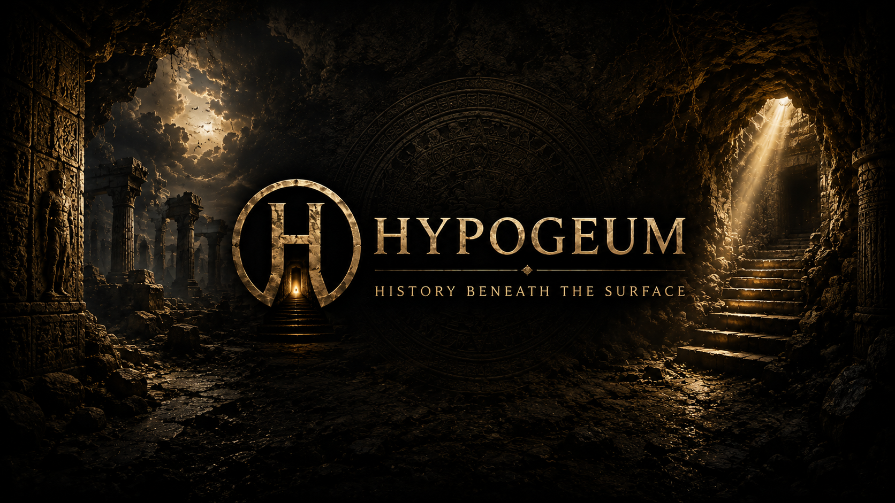
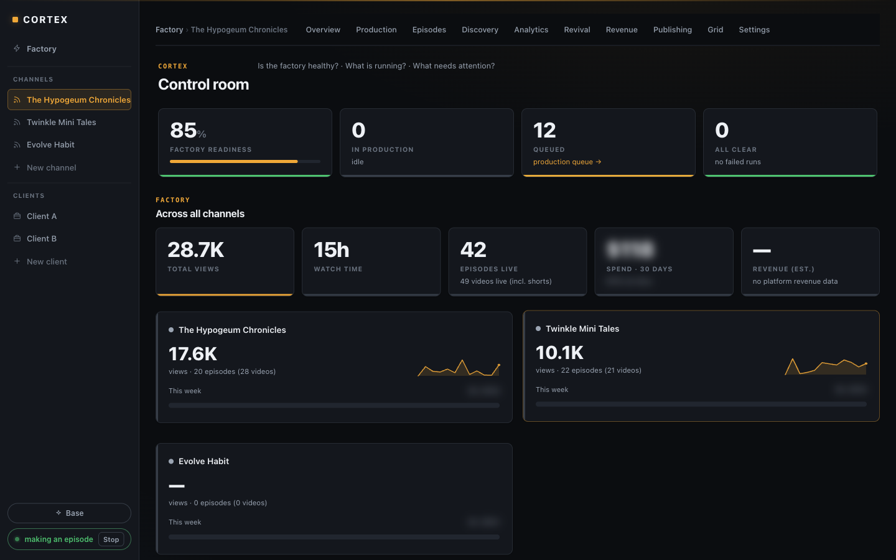
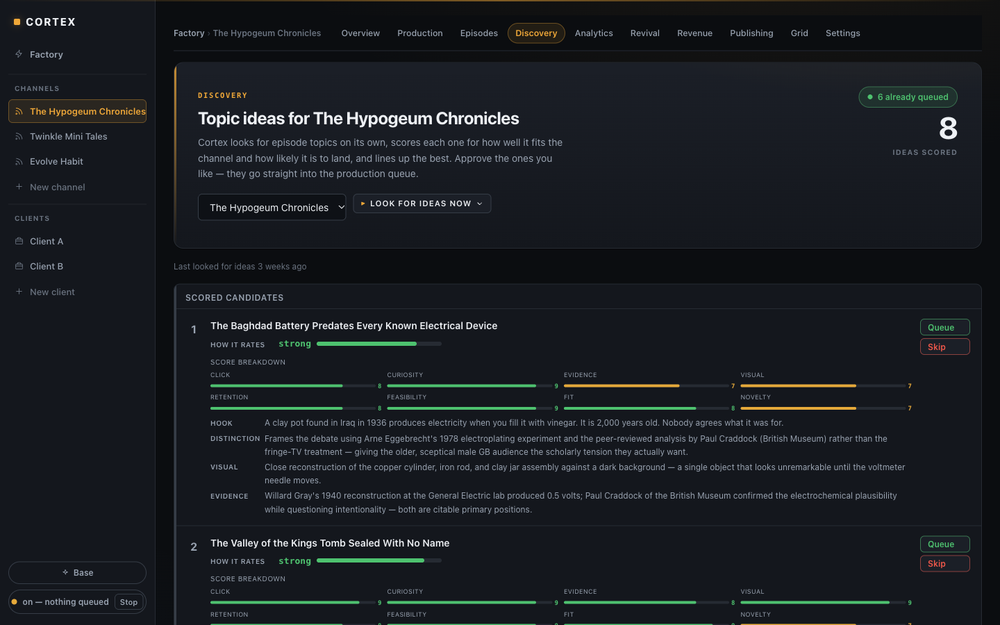
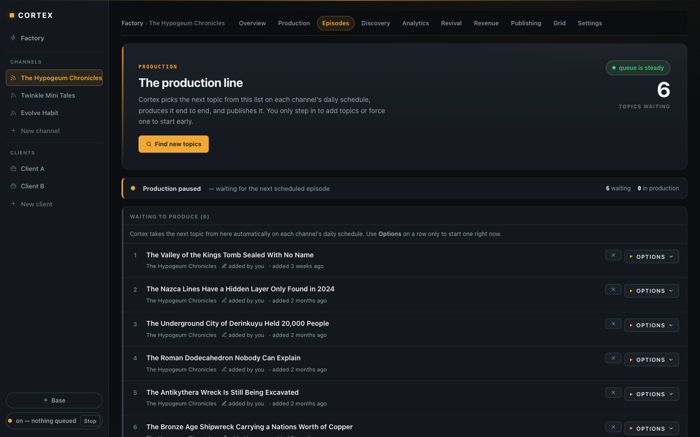
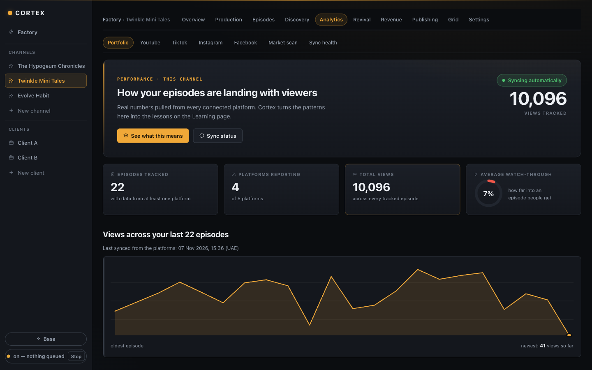
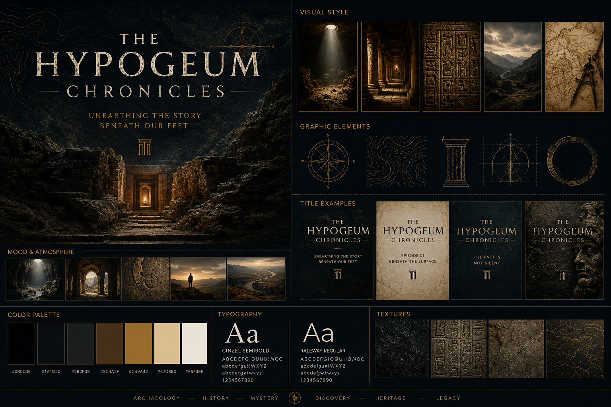
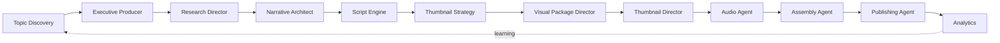

<div align="center">



# Cortex OS 🧠

### An Autonomous AI Media Factory — Topic to Published Video, Hands-Free

Give Cortex a channel brand and it **discovers topics**, **researches**, **writes**, **voices**, **films**, **edits**, **publishes** and **learns from real analytics** — for documentary episodes and Shorts, across multiple isolated channels.

[](LICENSE)
[](requirements.txt)
[](https://github.com/gawadeditor/cortex-os/stargazers)
[](https://github.com/gawadeditor/cortex-os/commits/main)
[](CONTRIBUTING.md)
[](https://github.com/gawadeditor/cortex-os/issues)

[Quick Start](#quick-start-) | [Features](#features-) | [Contributing](CONTRIBUTING.md) | [Architecture](CORTEX_ARCHITECTURE.md) | [Issues](https://github.com/gawadeditor/cortex-os/issues)

⭐ **If Cortex is useful or interesting to you, please star the repo — it helps others find it.**

</div>

Cortex is **not** a YouTube tool and **not** a workflow builder. It is a *factory OS*: a human sets the goals and the brand, and Cortex decides and executes production, then uses measured audience data to make the next episode better. It currently runs two real channels with completely different identities.

## Screenshots 🖥

<h4 align="center">Control room — all channels at a glance</h4>



<h4 align="center">Discovery — scored topic ideas with hook, evidence and rationale</h4>



<h4 align="center">Production line — approved topics queue up and are produced on each channel's schedule</h4>



<h4 align="center">Analytics — real audience numbers per platform feed back into future episodes</h4>



> Client names are replaced and spend figures blurred in these screenshots.

## Channels Built With Cortex 🎬

Two channels run on the same factory — different brand, voice, music library and audience. New channels are created by cloning a channel template.

<table width="100%">
  <tr>
    <td align="center" width="50%">
      <br>
      <b>Hypogeum Chronicles</b><br>History &amp; archaeology documentaries
    </td>
    <td align="center" width="50%">
      <br>
      <b>Twinkle Mini Tales</b><br>Calm bedtime stories for kids
    </td>
  </tr>
</table>

## How an Episode Is Made 🏭



Every agent's output is validated against a strict schema before the next stage runs; a failed validation halts the pipeline instead of passing bad data forward.

## Features 🎯

### Autonomous Production
- [x] **Topic discovery** — LLM + web research proposes topics, scores each for click, retention and fit, and explains why
- [x] **10-stage agent pipeline** — producer, research, narrative, script, thumbnail strategy, visuals, thumbnails, audio, assembly, publishing
- [x] **Long-form documentaries and vertical Shorts** (1080×1920) from the same pipeline
- [x] **Autonomous worker** — a scheduler → queue → pipeline loop that keeps the production buffer filled

### Quality
- [x] **Cinematic prompt architecture ("Video DNA")** — topic-agnostic camera, motion, lighting and historical-plausibility modules assembled into every scene prompt, so one improvement lifts every future episode
- [x] **Schema-validated hand-offs** between all agents
- [x] **Thumbnail QA** and concept-driven thumbnail generation
- [x] **Hook pattern library** — every script opens with a deliberate, tested hook move

### Safety & Control
- [x] **Budget gates** — per-episode, weekly and monthly spend ceilings, with a spend circuit-breaker
- [x] **Operator alerts** — every blocker is pushed to the operator (Telegram)
- [x] **Dry-run mode** — exercise the whole pipeline with no provider spend (`MUAPI_DRY_RUN=true`)
- [x] **Strict channel isolation** — brand, voice, music, policy and budget per channel

### Providers
- [x] **LLM** via OpenRouter (Claude) · **research** via Perplexity
- [x] **Video** via MUAPI (Veo 3.1 and other models) · **voice & music** via ElevenLabs, with optional local music generation
- [x] **Assembly** with FFmpeg
- [x] **Publishing** to YouTube, Facebook and Instagram (self-hosted Postiz)

### Learning
- [x] **Real analytics only** — mock data is never shown as KPIs
- [x] **Audience-aware** topic, script and thumbnail decisions from measured performance

## System Requirements 📦

| | Minimum |
|---|---|
| Python | 3.9+ |
| OS | macOS or Linux |
| FFmpeg | Required for video assembly |
| Provider keys | Only needed for real production — **not** needed for tests or dry runs |

## Quick Start 🚀

### Try it without any API keys

```bash
git clone https://github.com/gawadeditor/cortex-os.git
cd cortex-os
python3 -m venv .venv && source .venv/bin/activate
pip install -r requirements-dev.txt
cp .env.example .env

# placeholder keys are enough to explore: nothing is called in dry-run mode
export OPENROUTER_API_KEY=placeholder PERPLEXITY_API_KEY=placeholder \
       MUAPI_API_KEY=placeholder ELEVENLABS_API_KEY=placeholder MUAPI_DRY_RUN=true

python3 scripts/bootstrap_channel.py            # creates the local DB and the first channel
python3 -m pytest -q tests/test_pipeline.py     # 117 tests
python3 run_dashboard.py                        # open http://127.0.0.1:5001
```

### Run the pipeline in dry-run (no spend)

Set `MUAPI_DRY_RUN=true` in `.env`, then queue a topic from the dashboard, or for a single debug run:

```bash
python3 run_pipeline.py --topic "The Antikythera Mechanism" --episode-id ep_001
```

### Run for real

Fill in your provider keys in `.env` (see the comments in [`.env.example`](.env.example)) and set the budget ceilings you are comfortable with. Then:

```bash
python3 run_dashboard.py      # operator UI
python3 run_worker.py         # autonomous production loop
```

> ⚠️ Real production calls paid APIs (video generation is the main cost). Start with dry-run and low budget ceilings.

## Repository Map 🗺

| Path | Contents |
|---|---|
| `hypogeum/` | Core package: pipeline orchestrator, providers, DB, schemas |
| `hypogeum/agents/` | The individual production agents |
| `run_dashboard.py` | Operator dashboard |
| `run_worker.py` | Autonomous production loop |
| `run_pipeline.py` | Single-episode CLI (debugging) |
| `channel_packages/` | Per-channel brand, voice and policy packages |
| `docs/` | Architecture, governance and design documents |
| `tests/` | Test suite |

Start with [`PROJECT_NORTH_STAR.md`](PROJECT_NORTH_STAR.md), [`CORTEX_ARCHITECTURE.md`](CORTEX_ARCHITECTURE.md) and [`docs/architecture-index.md`](docs/architecture-index.md).

## Common Questions 🤔

<details>
<summary><b>Do I need paid API keys to try it?</b></summary>

No. Tests and dry-run mode need no keys. Keys are only needed to actually generate and publish videos.
</details>

<details>
<summary><b>How much does an episode cost?</b></summary>

It depends on the video model and episode length. Video generation dominates the cost; per-episode, weekly and monthly ceilings stop runaway spend. Use dry-run first.
</details>

<details>
<summary><b>Can I make my own channel?</b></summary>

Yes — channels are defined by a package (brand, voice, policies). See [`CHANNEL_PACKAGE_SPEC.md`](CHANNEL_PACKAGE_SPEC.md) and the dashboard's "New channel" flow.
</details>

<details>
<summary><b>Is it only for YouTube?</b></summary>

No. The factory is platform-agnostic; publishing currently targets YouTube, Facebook and Instagram, and new platforms are added as provider adapters.
</details>

## Contributing 🤝

Contributions are very welcome — new provider adapters, channel templates, dashboard improvements, tests and docs. Read [CONTRIBUTING.md](CONTRIBUTING.md), then look for issues labelled **good first issue** and **help wanted**.

## Feedback & Suggestions 📢

Open an [issue](https://github.com/gawadeditor/cortex-os/issues) or a [pull request](https://github.com/gawadeditor/cortex-os/pulls).

## License 📝

[MIT](LICENSE) © 2026 Muhamed Abdelgawad
