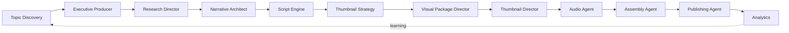

<div align="center">


# Cortex OS

**An autonomous, multi-agent operating system for media production.**
It finds topics, researches, writes, voices, films, edits, publishes and learns from analytics — across multiple channels, with minimal human operation.

</div>

---

## What is this?

Cortex is **not** a YouTube tool and **not** a workflow builder. It is a *factory OS*: a human defines the goals and the brand, and Cortex decides and executes the production of documentary-style episodes and Shorts end to end, then uses real analytics to improve the next ones.

The first channel built on it is **Hypogeum Chronicles** (history & archaeology documentaries). New channels are created by cloning a channel template with a different brand and topic configuration, while staying fully isolated from each other.

<p align="center">
  
</p>

## How an episode is made



| Stage | What it does |
|---|---|
| **Executive Producer** | Scores the topic (accept / warn / reject) and writes the topic brief |
| **Research Director** | Runs research queries and builds the research package |
| **Narrative Architect** | Designs the story structure |
| **Script Engine** | Writes narration beats and matching visual directions |
| **Thumbnail Strategy** | Proposes click-through-rate concept hypotheses |
| **Visual Package Director** | Plans scenes and generates video clips |
| **Thumbnail Director** | Generates and QA-checks thumbnail candidates |
| **Audio Agent** | Narration (ElevenLabs) and music |
| **Assembly Agent** | FFmpeg render of the final video |
| **Publishing Agent** | Uploads and schedules to the channel's platforms |

Every agent output is validated against a strict schema before it reaches the next stage; a failed validation halts the pipeline instead of passing bad data forward.

## Key ideas

- **Operator dashboard** — a Flask web app: discover topics with a score and rationale, queue them, start runs, track progress live, and read real (never mock) analytics.
- **Autonomous worker** — a scheduler → queue → pipeline loop that keeps the production buffer filled.
- **Budget & safety gates** — per-episode, weekly and monthly spend ceilings; provider leases; operator alerts on every blocker.
- **Cinematic prompt architecture** — a topic-agnostic "Video DNA" (camera, motion, lighting, historical-plausibility modules) assembled into every scene prompt, so quality improvements apply to all future episodes.
- **Brand isolation** — each channel has its own brand identity, voice, music library, policies and budget.
- **Learning loop** — measured audience data feeds back into topic selection, scripts and thumbnails.

## Repository map

| Path | Contents |
|---|---|
| `hypogeum/` | Core package: agents, pipeline orchestrator, providers, DB, schemas |
| `hypogeum/agents/` | The individual production agents |
| `run_dashboard.py` | Operator dashboard (`http://127.0.0.1:5001`) |
| `run_worker.py` | Autonomous production loop |
| `run_pipeline.py` | Single-episode CLI (debugging tool) |
| `channel_packages/` | Per-channel brand, voice and policy packages |
| `docs/` | Architecture, governance and design documents |
| `tests/` | Test suite |

Start with [`PROJECT_NORTH_STAR.md`](PROJECT_NORTH_STAR.md), [`CORTEX_ARCHITECTURE.md`](CORTEX_ARCHITECTURE.md) and [`docs/architecture-index.md`](docs/architecture-index.md).

## Quick start

```bash
cp .env.example .env          # add your own provider keys
python3 -m pytest -q          # run the test suite
python3 run_dashboard.py      # operator dashboard
python3 run_worker.py --dry-run   # exercise the loop without calling providers
```

Provider keys (LLM, video, voice, publishing) are read from `.env` only and are never committed.

## Status

Active, in production on real channels. This repository is shared for transparency and portfolio purposes; it is not a packaged, ready-to-install product.

## License

All rights reserved unless a license file states otherwise.
